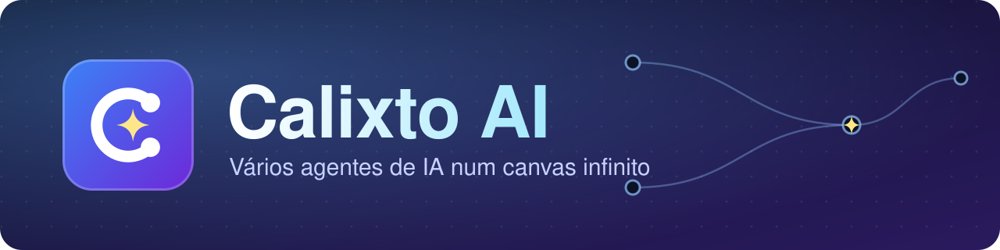

<div align="center">



<br>

**Coloque vários agentes de IA para trabalhar juntos num canvas infinito.**
Cada agente roda num terminal de verdade, e você liga os terminais por fios para eles conversarem, dividirem tarefas e se avisarem quando terminam.

<br>


<br>

### [⬇️ Baixar o instalador](https://github.com/kauecalixto/CalixtoAI/raw/main/Calixto-AI-Setup.exe)

<sub>Um arquivo só · sem pedir administrador · abre o app no fim</sub>

</div>

---

<p align="center">
  <a href="#instalar">Instalar</a> ·
  <a href="#primeiros-passos">Primeiros passos</a> ·
  <a href="#como-funciona-referência">Referência</a> ·
  <a href="#agentes-conversando">CLI</a> ·
  <a href="#portal-navegador-para-pesquisa-e-testes">Portal</a> ·
  <a href="#onde-ficam-seus-dados">Dados</a> ·
  <a href="#segurança">Segurança</a>
</p>

> [!NOTE]
> Só Windows 10/11 (64 bits). O instalador não é assinado: o SmartScreen pode avisar "editor desconhecido". Clique em **Mais informações → Executar assim mesmo**.

## Instalar

1. Baixe o [`Calixto-AI-Setup.exe`](https://github.com/kauecalixto/CalixtoAI/raw/main/Calixto-AI-Setup.exe). Se clonar o repositório em vez de baixar, rode `git lfs pull` para receber o arquivo completo.
2. Abra o arquivo. Uma janela de console mostra o progresso e, no fim, o Calixto AI abre sozinho.
3. O instalador copia o app para `%LOCALAPPDATA%\Programs\Calixto AI` e cria atalhos na Área de Trabalho e no Menu Iniciar. Não pede administrador.

**Atualizar:** rode o instalador novo; ele fecha o Calixto aberto e troca os arquivos. Seus projetos e configurações ficam em outra pasta e não são tocados.

**Desinstalar:** apague a pasta `%LOCALAPPDATA%\Programs\Calixto AI` e os dois atalhos. Para apagar também seus dados, apague `%APPDATA%\calixto-ai` e `%USERPROFILE%\.calixto`.


## Para que serve

Quando você usa um agente de IA no terminal (Claude Code, Codex etc.), ele trabalha sozinho, numa janela, sem saber que existe outro. O Calixto AI resolve isso:

| Problema do dia a dia | O que o Calixto faz |
|---|---|
| Várias janelas de terminal soltas, difícil saber quem está fazendo o quê | Todos os terminais ficam num só canvas, com nome, cor e estado (trabalhando ou ocioso) |
| Você precisa copiar a resposta de um agente e colar em outro | Um agente pergunta direto ao outro e recebe a resposta real |
| Um agente termina e ninguém fica sabendo | O resultado é digitado sozinho no terminal de quem pediu |
| Dois agentes editam o mesmo arquivo e um estraga o trabalho do outro | Trava de arquivo: quem pegou primeiro libera depois |
| Testar um site ou pesquisar na web exige sair da ferramenta | O navegador (portal) fica no canvas, e o agente o controla |
| Fechou a janela e perdeu o que estava rodando | Os terminais continuam vivos em segundo plano |

## Primeiros passos

Cada passo diz **o que fazer**, **para que serve** e o que você deve ver.

### 1. Crie um projeto (workspace)
- **Como:** na barra lateral, digite um nome e clique em criar. Ou use **Escolher uma pasta do computador como projeto** para ligar o canvas a uma pasta que já existe.
- **Para que serve:** separa seus trabalhos. Cada projeto tem o próprio canvas, terminais e notas, sem misturar com os outros.
- **Você vê:** um canvas vazio. Arraste para mover a câmera e use o zoom para se afastar ou aproximar.

### 2. Abra um terminal
- **Como:** tecla `T` ou o botão de terminal na barra de ferramentas do canvas. Escolha o shell (PowerShell, cmd, WSL...).
- **Para que serve:** é onde o agente roda. É um terminal de verdade: tudo o que você roda no Windows roda aqui.
- **Você vê:** um cartão com o terminal. Digite `claude` (ou `codex`, ou o programa que você usa) e ele inicia ali dentro. Esses programas precisam estar instalados e com login feito.

### 3. Dê nome e função ao agente
- **Como:** selecione o cartão e pressione `F2` para renomear. Para dar uma função, use o botão de **Presets e Papéis** no topo, ou, dentro de outro terminal, `calixto role assign "Nome" "função" --prompt "instruções"`.
- **Para que serve:** o nome é como os outros agentes o chamam (`calixto ask "Revisor" ...`). A função diz o que ele deve fazer ("revisão de segurança", "testes"...) e vale como instrução inicial.
- **Dica:** use nomes curtos e distintos, como `Backend`, `Revisor`, `QA`.

### 4. Ligue os agentes com um fio
- **Como:** pressione `L` (modo conectar), clique no primeiro cartão e depois no segundo. Também dá pelo botão **Conectar** no menu do cartão.
- **Para que serve:** o fio é a **permissão**. Um agente só fala com quem está ligado a ele. Assim você decide quem pode pedir coisas a quem, e nada acontece por acidente.
- **Você vê:** uma curva ligando os dois cartões. O fio pode ser de mão única (A pede a B, mas B não pede a A).

### 5. Peça algo de um agente a outro
- **Como:** no terminal do agente que vai pedir, rode:
  ```
  calixto ask "Revisor" "Revise o arquivo src/login.ts e liste os problemas de segurança por gravidade"
  ```
  Ou deixe o próprio agente fazer isso: diga a ele "peça ao Revisor para revisar o login".
- **Para que serve:** o pedido é digitado no terminal do Revisor, e a resposta real volta para quem perguntou. Você não copia e cola nada.
- **Dica:** seja específico (objetivo, onde olhar, formato da resposta), porque o outro agente **não vê** a sua conversa.

### 6. Delegue sem esperar
- **Como:**
  ```
  calixto task send "Backend" "Crie o endpoint POST /login e rode os testes" --async
  ```
- **Para que serve:** o agente que pediu continua trabalhando enquanto o outro faz a tarefa. Quando o outro terminar, o resultado aparece sozinho no terminal de quem pediu, e a tarefa fecha como concluída (ou como "parou sem concluir", se o agente travou).
- **Acompanhe:** `calixto tasks list` mostra todas as tarefas; `calixto task result <id>` mostra o resultado de uma.

### 7. Veja quem está trabalhando
- **Como:** `calixto agents list` ou `calixto agent check "Nome"`.
- **Para que serve:** mostra o estado **real** (trabalhando ou ocioso há X minutos, pela última saída do terminal). Evita achar que um agente travou quando ele só está demorando, ou o contrário.

### 8. Deixe o agente montar o time
- **Como:** o agente principal roda `calixto recruit "Testador" --preset <preset> --role "escrever testes"`. Para tirar, `calixto dismiss "Testador"`.
- **Para que serve:** o orquestrador cria novos agentes já ligados a ele quando precisa de ajuda, e os dispensa quando termina. Você não precisa montar o canvas na mão.

### 9. Use notas para compartilhar contexto
- **Como:** tecla `N` cria uma nota; ligue-a aos agentes por fios. Os agentes usam `calixto note read "Nome"` e `calixto note write "Nome" "texto"`. Notas marcadas como `locked` são só leitura.
- **Para que serve:** um lugar comum para plano, decisões e requisitos. Todos leem a mesma fonte, e você também edita (em Markdown).

### 10. Evite que dois agentes editem o mesmo arquivo
- **Como:** antes de editar, o agente roda `calixto lock acquire src/app.ts`. Ao terminar, `calixto lock release src/app.ts`. `calixto lock list` mostra as travas.
- **Para que serve:** é uma trava cooperativa: o segundo agente vê que o arquivo está ocupado e espera ou escolhe outro. Evita sobrescrever o trabalho do colega.

### 11. Pesquise e teste no navegador do canvas
- **Como:** `P` cria um portal, ou o agente roda `calixto portal create https://exemplo.com`. Depois, `calixto portal text` lê a página, `portal elements` lista botões e campos com o seletor pronto, `portal click`/`fill` agem, `portal screenshot` tira uma foto.
- **Para que serve:** pesquisar na web e **testar a interface** do app que o time está construindo (QA), sem sair do canvas. O agente também lê erros de JavaScript e falhas de rede com `portal console`.

### 12. Guarde seu arranjo
- **Como:** botão **Arranjos** no topo: salve o conjunto de nós atual e reutilize ou exporte em `.json`.
- **Para que serve:** monta de novo o mesmo time (por exemplo, Orquestrador + Backend + Revisor + QA) em um projeto novo, com um clique.

## Um exemplo completo

1. Crie o projeto "Loja" e abra 3 terminais: `Chefe`, `Backend` e `Revisor`.
2. Em cada um, inicie o seu agente (por exemplo, `claude`).
3. Ligue `Chefe → Backend` e `Chefe → Revisor` com `L`.
4. No `Chefe`, peça: *"Peça ao Backend para criar o endpoint de login. Quando terminar, peça ao Revisor para revisar."*
5. O Chefe roda `calixto task send "Backend" "..." --async`. O Backend trabalha, e o resultado cai sozinho no terminal do Chefe.
6. O Chefe então roda `calixto ask "Revisor" "Revise o que o Backend fez em src/login.ts"` e recebe a revisão.
7. Você acompanha tudo no canvas, com cada agente em seu cartão e o estado de cada um à vista.

## Como funciona (referência)

### Workspaces e canvas
- Um **workspace** (projeto) é um canvas infinito com pan e zoom. Você pode ter quantos quiser; cada um é isolado dos outros. Também dá para usar uma pasta do computador como projeto.
- No canvas você cria **nós**:

| Nó | Atalho | Para quê |
|---|---|---|
| Terminal / agente | `T` | Um terminal real (PowerShell, cmd, WSL...). Vira **agente** quando recebe um nome e uma função |
| Árvore de arquivos | `F` | Navega e edita arquivos de uma pasta |
| Portal | `P` | Navegador dentro do canvas, que os agentes também controlam |
| Nota | `N` | Nota adesiva em Markdown, que os agentes leem e escrevem |
| Texto | `X` | Anotação livre |

- `L` liga dois nós com um fio. `Espaço` recentraliza a câmera, `F2` renomeia, `Ctrl+K` abre a paleta de comandos, `Ctrl+,` as configurações.
- Os **arranjos** guardam um conjunto de nós para reutilizar ou exportar em `.json`.

### Terminais que sobrevivem
Cada terminal roda num processo separado do app (um daemon local). Se a janela fechar ou travar, os terminais e o histórico continuam, e ao reabrir você os encontra de volta.

### Conexões = permissão
Um agente só enxerga e fala com o que estiver **ligado a ele por um fio** no canvas. Sem fio, o pedido é recusado. O fio pode ser de mão única (A pode pedir a B, mas B não pode pedir a A).

### Agentes conversando
Dentro de qualquer terminal do Calixto existe a CLI `calixto`. Um agente (ou você) usa:

| Comando | O que faz |
|---|---|
| `calixto list` | Mostra os nós e fios ligados a este terminal (`--all` mostra tudo) |
| `calixto ask "Nome" "pedido"` | Pergunta a outro agente e devolve a resposta real dele |
| `calixto ask --batch '{"A":"...","B":"..."}'` | Vários agentes ao mesmo tempo |
| `calixto task send "Nome" "pedido" --async` | Manda uma tarefa e continua trabalhando |
| `calixto tasks list` / `task result <id>` | Acompanha as tarefas |
| `calixto agent check "Nome"` | Estado real: trabalhando ou ocioso há X |
| `calixto recruit "Nome" --preset <p> --role <papel>` | Cria um agente novo já ligado a você |
| `calixto dismiss "Nome"` | Remove um agente recrutado |
| `calixto role assign "Terminal" "função" --prompt "..."` | Dá uma responsabilidade a um terminal |
| `calixto connect "A" "B"` | Liga dois nós |
| `calixto note create/read/write/edit/delete` | Notas compartilhadas |
| `calixto lock acquire/release/list <arquivo>` | Trava cooperativa para dois agentes não editarem o mesmo arquivo |
| `calixto portal ...` | Controla o navegador do canvas (abaixo) |

`calixto help` lista o resto. Códigos de saída: 0 ok, 1 argumentos, 2 não encontrado, 3 autenticação, 4 permissão negada, 5 erro do daemon. A CLI só funciona em terminais abertos dentro do Calixto.

**Aviso automático de término:** quando um agente termina uma tarefa pedida por outro, o resultado é digitado sozinho no terminal de quem pediu e a tarefa fecha como concluída (ou como "parou sem concluir"). Isso vale mesmo com `--async`, com timeout ou com fio de mão única. O agente não precisa lembrar de reportar.

### Portal (navegador para pesquisa e testes)
`calixto portal create <url>` abre uma página ao lado do terminal. Daí o agente pode ler (`text`, `links`, `elements`, `snapshot`), agir (`click`, `fill`, `press`, `scroll`, `navigate`), esperar (`wait`), inspecionar (`eval`, `console`) e tirar `screenshot`. Serve para pesquisar na web e para testar a interface de um app.

### Presets e responsabilidades
Os **presets** são modelos de agente prontos (qual programa roda e com que instruções). As **responsabilidades** são funções em texto livre ("Revisão de segurança"), que você pode salvar e reaproveitar.

## Onde ficam seus dados
- Banco, backups e configurações: `%APPDATA%\calixto-ai`.
- Notas e histórico dos terminais: `%USERPROFILE%\.calixto`.
- Chaves de API: guardadas cifradas com o DPAPI do Windows (só o seu usuário nesta máquina consegue abrir).
- O app tem backup com restauração e, se o banco corromper, ele é posto em quarentena em vez de apagado.

## Segurança
- A comunicação entre o app e o daemon usa um *named pipe* local com token, sem abrir porta de rede.
- Cada terminal recebe um token próprio e temporário; é ele que limita o que o agente enxerga.
- A interface roda com CSP restrita e sem acesso direto ao sistema; o acesso a arquivos é protegido contra `..` e caminhos fora da pasta.

## Limitações conhecidas
- Só Windows 64 bits. O instalador não é assinado.
- Os agentes (Claude Code, Codex etc.) são programas separados: você precisa tê-los instalados e logados.
- Testado com terminais reais, mas ainda não com dezenas de agentes reais trabalhando ao mesmo tempo em outras máquinas.
